# Jellyfin Plus

**Jellyfin in Home Assistant that reacts instantly and doesn't break when an app restarts.**



- **Instant:** Jellyfin tells Home Assistant about every play, pause and seek the moment it
  happens. Nothing is polled.
- **Stable:** every Jellyfin app (Apple TV, iPhone, browser, …) gets one media player that
  always stays the same, even after the app restarts.
- **Made for automations:** lights down when a movie starts, up when the credits roll, a
  notification when a new episode arrives.

## Install

1. **Settings → Marketplace → Add from link** → `MineMax6543/HA-jellyfin`
2. Install **Jellyfin Plus**.
3. **Settings → Devices & services → Add integration → Jellyfin Plus.**

## Connect

Choose how to log in:

| | When to use |
|---|---|
| **API key** (recommended) | Create one in Jellyfin under *Dashboard → API Keys*. Works for every user, no extra permissions needed. |
| **Username & password** | Use an **administrator** account. On Jellyfin 12, also enable *Allow remote control of other users*. |

## What you get

| | |
|---|---|
| 🎬 **Media player** per app | what's playing, poster, play/pause/seek, volume, browse your libraries, resume where you left off |
| 🎮 **Remote** per app | up, down, select, back, home |
| ⚡ **Events** | playback started / paused / resumed / stopped, intro and credits*, new in the library |
| 📊 **Sensors** | Next up, active streams, movie/series/episode counts, free space |
| 📅 **Calendar** | upcoming episodes of your shows |
| 💬 **Actions** | show a message on the TV, mark as watched, favorite |
| 🛠️ **Server** | Jellyfin and plugin updates, library scan, backup, restart |

\* Intro and credits need a Jellyfin plugin that detects them, such as *Intro Skipper*.

## Examples

**Movie mode:** lights off when a movie or episode plays, dimmed back on when it pauses
or stops.

```yaml
triggers:
  - trigger: state
    entity_id: event.living_room_apple_tv_playback
conditions:
  - "{{ trigger.to_state.attributes.item_type in ['Movie', 'Episode'] }}"
actions:
  - variables:
      what: "{{ trigger.to_state.attributes.event_type }}"
  - choose:
      - conditions: "{{ what in ['playback_started', 'playback_resumed'] }}"
        sequence:
          - action: light.turn_off
            target: { area_id: living_room }
      - conditions: "{{ what in ['playback_paused', 'playback_stopped'] }}"
        sequence:
          - action: light.turn_on
            target: { area_id: living_room }
            data: { brightness_pct: 40 }
```

**Doorbell on the TV:** pause and show who's there.

```yaml
action: jellyfin_plus.send_message
target:
  entity_id: media_player.living_room_apple_tv
data:
  title: Front door
  message: Someone is at the door
  pause: true
```

## Several people

Under **Jellyfin Plus → Configure**, link each Home Assistant user to their Jellyfin
account. Everyone then continues where *they* stopped and gets their own *Next up*,
*Currently watching* and calendar.


## Something wrong?

**Jellyfin Plus → ⋮ → Download diagnostics** right after it happened, and attach the file
to an [issue](https://github.com/MineMax6543/HA-jellyfin/issues). It contains the last few
minutes of what Jellyfin sent; tokens, IPs and user names are removed.

---

All entities, event fields and options: **[docs/reference.md](docs/reference.md)**
