<p align="center">
  
</p>

<h1 align="center">Jellyfin Plus</h1>

<p align="center">
  Jellyfin in Home Assistant that reacts instantly and doesn't break when an app restarts.<br>
  <a href="https://github.com/MineMax6543/ha-jellyfin-plus/releases"></a>
  <a href="https://www.home-assistant.io"></a>
</p>

---

Jellyfin Plus talks to your [Jellyfin](https://jellyfin.org) server. Every play, pause and seek
reaches Home Assistant **the moment it happens** (no polling), and every Jellyfin app gets
**one media player that always stays the same**, even after the app restarts.


## Setup

1. **In Jellyfin:** *Dashboard → API Keys → +*, name it e.g. *Home Assistant*.
2. **In the Marketplace:** *Settings → Marketplace → Add from link* → `MineMax6543/ha-jellyfin-plus`, install **Jellyfin Plus**, and restart Home Assistant.
3. **In Home Assistant:** *Settings → Devices & services → Add integration → Jellyfin Plus*, enter your server URL, choose **API key** and paste it.

> **Tip:** you can also log in with **username & password**. Use an administrator account, and on Jellyfin 12 also enable *Allow remote control of other users*.

## What you get

| Area | Highlights |
|---|---|
| 🎬 **Media player** | One per app: what's playing, poster, play/pause/seek, volume, browse and search your libraries, resume where you left off |
| 🎧 **Tracks** | Audio track and subtitle selects per app |
| 🎮 **Remote** | Up, down, select, back, home; turning it off stops playback |
| ⚡ **Events** | Playback started / paused / resumed / stopped, intro and credits*, new in the library, activity log |
| 📊 **Sensors** | Next up, recently added, active streams, bandwidth, movie/series/episode counts, free space |
| 📅 **Calendar** | Upcoming episodes of your shows |
| 💬 **Actions** | Message on the TV, sleep timer, mark as watched, favorite |
| 🛠️ **Server** | Jellyfin and plugin updates, library scan, backup, restart, running tasks |

\* Intro and credits need a Jellyfin plugin that detects them, such as *Intro Skipper*.

### Several people

Under **Jellyfin Plus → Configure**, link each Home Assistant user to their Jellyfin account.
Everyone then continues where *they* stopped and gets their own *Next up*, *Currently watching*
and calendar.



| Option | Does |
|---|---|
| People folder | A *People* folder in the media browser to browse as someone else |
| Add to shared sessions | Adds the person to a shared app's session, so Jellyfin saves the progress for them too |
| Library user (API key) | Whose libraries, *Next up* and counts are shown by default |

## Staying connected

- Media players stay the same entity across app restarts, because they're tied to the device, not the session. A closed app is *off*, not *unavailable*.
- If the server is down, entities show as *unavailable* and come back on their own.
- Admin rights are re-checked every 5 minutes; granting them in Jellyfin needs no re-setup.

## Good to know

<details>
<summary><b>⚡ Events and their data</b></summary>

| Entity / bus event | Fires |
|---|---|
| `event.<app>_playback` | playback of that app |
| `event.<server>_playback_all_clients` | playback of any app |
| bus `jellyfin_plus_playback` | the same, for YAML (`action` instead of `event_type`) |
| `event.<server>_library`, bus `jellyfin_plus_library` | `item_added`: new movie, episode, series, album, video |
| `event.<server>_activity`, bus `jellyfin_plus_activity` | Jellyfin's activity log (administrators) |

**Playback types:** `playback_started`, `playback_paused`, `playback_resumed`, `playback_stopped`,
and with a segment plugin `intro_started` / `intro_ended`, `credits_*`, `recap_*`, `preview_*`,
`commercial_*`. Credits are timed by Jellyfin Plus itself, so they fire when the credits begin.

**Playback data:** `device_name`, `device_id`, `client`, `user_name`, `user_id`, `ha_user_id`,
`title`, `item_id`, `item_type`, `media_type`, `series_name`, `season_number`, `episode_number`,
`year`, `runtime`, `position` (seconds), `is_paused`, `play_method`, `is_transcoding`, and for
segments `segment`, `segment_start`, `segment_end`.

**Library data:** `item_id`, `title`, `item_type`, `series_name`, `season_number`,
`episode_number`, `year`, `image_url`.

**Activity types:** `login_failed`, `login_succeeded`, `user_locked_out`, `task_failed`,
`plugin_installed`, `plugin_updated`, `plugin_uninstalled`, `plugin_install_failed`,
`user_created`, `user_deleted`, `user_password_changed`, `other`.
</details>

<details>
<summary><b>🎬 Movie mode automation</b></summary>

Lights off when a movie or episode plays, dimmed back on when it pauses or stops.

```yaml
triggers:
  - trigger: state
    entity_id: event.living_room_apple_tv_playback
conditions:
  - "{{ trigger.to_state.attributes.item_type in ['Movie', 'Episode'] }}"
actions:
  - variables:
      what: "{{ trigger.to_state.attributes.event_type }}"
  - choose:
      - conditions: "{{ what in ['playback_started', 'playback_resumed'] }}"
        sequence:
          - action: light.turn_off
            target: { area_id: living_room }
      - conditions: "{{ what in ['playback_paused', 'playback_stopped'] }}"
        sequence:
          - action: light.turn_on
            target: { area_id: living_room }
            data: { brightness_pct: 40 }
```
</details>

<details>
<summary><b>💬 Message on the TV, sleep timer, watched and favorites</b></summary>

| Action | Fields |
|---|---|
| `jellyfin_plus.send_message` | target media player; `message`, `title`, `timeout` (s, 0 = until dismissed), `pause` |
| `jellyfin_plus.sleep_timer` | target media player; `minutes` **or** `end_of_item: true`; `action` `pause` / `stop` |
| `jellyfin_plus.cancel_sleep_timer` | target media player |
| `jellyfin_plus.mark_played` / `mark_unplayed` | `item_id`; optional `jellyfin_user`, `config_entry_id` |
| `jellyfin_plus.set_favorite` | `item_id`, `favorite`; optional `jellyfin_user`, `config_entry_id` |

```yaml
action: jellyfin_plus.send_message
target:
  entity_id: media_player.living_room_apple_tv
data:
  title: Front door
  message: Someone is at the door
  pause: true
```

The sleep timer shows up in the attributes `sleep_timer` and `sleep_timer_ends`. *End of
item* acts just before the next episode would start.
</details>

<details>
<summary><b>🎮 Remote commands</b></summary>

`remote.send_command` with Jellyfin command names (`MoveUp`, `Select`, `Back`, `GoHome`, …) or
the short forms `up`, `down`, `left`, `right`, `select`, `back`, `home`, `menu`, `volume_up`,
`volume_down`, `mute`. The attribute `supported_commands` lists what the app understands.

```yaml
action: remote.send_command
target:
  entity_id: remote.living_room_apple_tv_remote
data:
  command: [down, down, select]
```
</details>

<details>
<summary><b>📊 Sensors, calendar and server entities</b></summary>

| Entity | |
|---|---|
| *Next up* | episodes in Jellyfin's Next up, list in `episodes` |
| *Recently added* | newest item; newest 15 with posters in `items`, refreshes as soon as something is added |
| *Movies*, *Series*, *Episodes*, *Songs*, … | library counts |
| *Active streams*, *Transcoding streams*, *Streaming bandwidth*, *Connected clients* | live |
| Calendar *Upcoming episodes* | all-day events on the air date |
| *Running tasks*, *… free space* | administrators / API key |
| Update *Server*, Update *… plugin* | newer Jellyfin release (checked on GitHub every 6 h), plugin updates you can install |
| Buttons | *Scan library*, *Create backup*, *Restart* |
</details>

<details>
<summary><b>🔑 API key or username & password?</b></summary>

| | API key | Username & password |
|---|---|---|
| Sees | every user's playback and data | its own; everyone's if administrator |
| Controls | every app | its own apps; others with *Allow remote control of other users* (Jellyfin 12+) |
| Server features | always | administrators only |
| Stored | the key | an access token, never the password |
</details>

## Troubleshooting

| Problem | Fix |
|---|---|
| Something behaves oddly | **Jellyfin Plus → ⋮ → Download diagnostics** right after it happened and attach it to an [issue](https://github.com/MineMax6543/ha-jellyfin-plus/issues). Tokens, IPs and user names are removed. |
| Commands fail with 403 (Jellyfin 12) | Use an API key, or enable *Allow remote control of other users* for the login |
| Progress bar runs ahead while playing, correct when paused | The clock of the device showing the dashboard is off. Sync its time. |
| An app has no media player | Only apps that support remote control get one (e.g. not every browser tab) |
| More detail in the log | **⋮ → Enable debug logging**: every command and position decision |

## Development

```sh
pip install pytest-homeassistant-custom-component
pytest
```

The tests run the integration inside a real Home Assistant instance against a fake Jellyfin server.

<sub>Not affiliated with the Jellyfin project. Jellyfin is a trademark of its owners.</sub>
